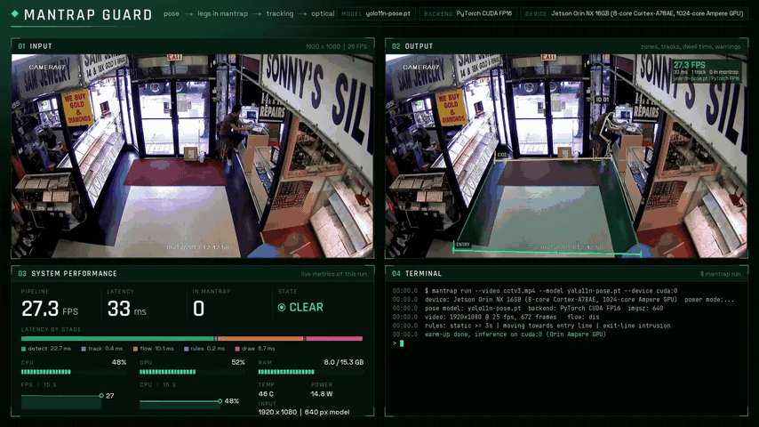
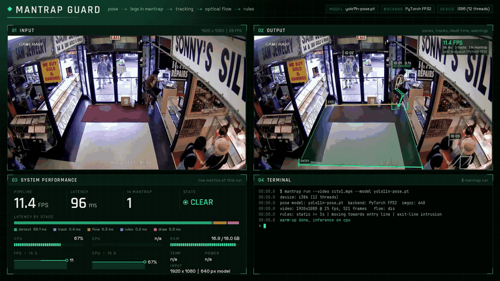
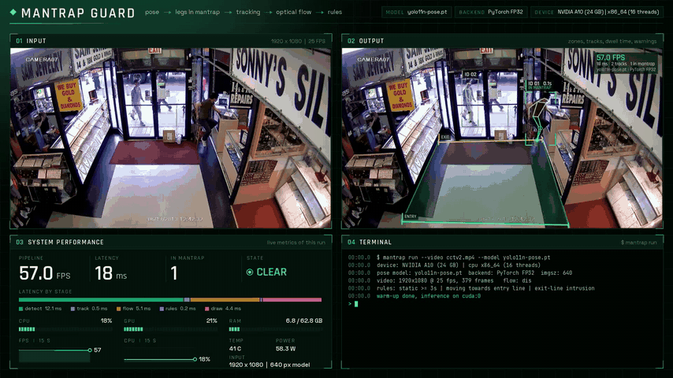
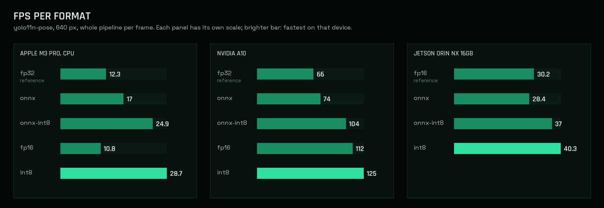
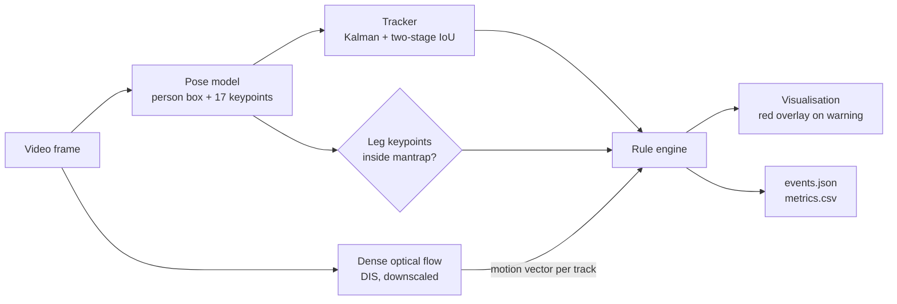
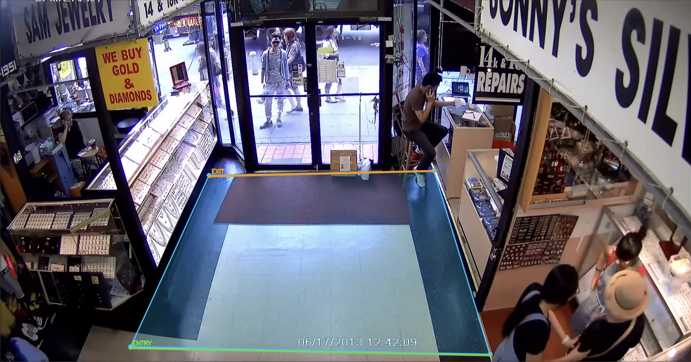

# Edge AI Monitioring

**Real-time mantrap / exit-lane monitoring: pose estimation, tracking, optical flow and a rule engine, optimised from PyTorch to ONNX, FP16 and INT8 and benchmarked on a laptop CPU, an NVIDIA A10 server GPU and an NVIDIA Jetson Orin NX 16GB.**



*Jetson Orin NX 16GB, CCTV clip `cctv3`. Top: input and output (mantrap zone, entry/exit lines, tracked skeletons, time in the mantrap, optical-flow direction, red warning overlay). Bottom: live system statistics and the terminal log of the same run.*

| **40 FPS** on Jetson Orin NX 16GB (INT8) | **125 FPS** on NVIDIA A10 (INT8) | **2.3x faster** on a laptop CPU (INT8 vs FP32) |
|:---:|:---:|:---:|
| 24.8 ms per frame, above the 25 FPS of the camera | 8.0 ms per frame, 1.9x the FP32 model | 12.3 FPS to 28.7 FPS on an Apple M3 Pro |

---

## About this repository

This is a **public, pre-defined demonstration** of a production system I built for automated exit gates (mantraps).

The **original project uses customised models that are not published**. They were trained to catch these fraud actions:

1. A person **entering through the exit gate**, possibly hiding in the "spider-man" position.
2. A person or object **stationary in the mantrap** area.
3. A person **standing on the ground link edges** in the mantrap area.
4. An **object left in the mantrap**, such as a backpack, wallet or suitcase.

This repository **uses published models instead** (Ultralytics YOLO11 pose and COCO detection weights) to show two things:

- **the pipeline and its rules**, end to end, on any video;
- **the capability to optimise the models for an NVIDIA Jetson Orin NX 16GB**: ONNX, TensorRT FP16 and TensorRT INT8 with on-site calibration, plus a benchmark that reports speed and accuracy drift per variant.

What the published models can and cannot show:

| Fraud action (production) | In this demo |
|---|---|
| 1. Entering through the exit gate | Shown: exit-line crossing + "moving towards the entry line" from optical flow. The spider-man posture itself needs the custom model. |
| 2. Person or object stationary | Shown for people (3 s rule). Objects: optional COCO detector (`--objects-model`). |
| 3. Standing on the ground link edges | Not included: needs the custom model. |
| 4. Object left in the mantrap | Partly: backpack, handbag, suitcase are COCO classes. Wallet needs the custom model. |

No production code, weights or footage are in this repository. The repository and the benchmark below contain only the resources and information I am permitted to share: they show the main purpose of the project, without the fine-tuned models and without the production pipeline (the double free-flow gate system).

---

## Demo on three devices

The same pipeline (yolo11n-pose, 640 px) on three CCTV clips, each run on a different machine. Every number in the dashboards is measured live by that machine during the run.

<table>
<tr>
<td align="center" width="33%"><b>Apple M3 Pro, CPU</b><br><sub><code>cctv1</code>, PyTorch FP32</sub></td>
<td align="center" width="33%"><b>NVIDIA A10, AWS</b><br><sub><code>cctv2</code>, PyTorch FP32</sub></td>
<td align="center" width="33%"><b>Jetson Orin NX 16GB, cloud</b><br><sub><code>cctv3</code>, PyTorch CUDA FP16</sub></td>
</tr>
<tr>
<td><a href="assets/cctv1.mp4"></a></td>
<td><a href="assets/cctv2.mp4"></a></td>
<td><a href="assets/cctv3.mp4"></a></td>
</tr>
</table>

Click a preview for the full video. A 39-second overview of the project, the three runs and the benchmark: [`assets/mantrap_guard_promo.mp4`](assets/mantrap_guard_promo.mp4).

---

## Benchmark

### Devices

All three machines were used for this benchmark.

| Device | Machine | Processing unit | Memory | Demo clip |
|---|---|---|---|---|
| CPU | Apple MacBook Pro, M3 Pro | CPU, 12 threads | 18 GB unified | `cctv1` |
| NVIDIA A10 | AWS instance with an NVIDIA A10 (24 GB) | GPU; host x86_64, 16 threads | 64 GB RAM | `cctv2` |
| Jetson Orin NX 16GB | Cloud Jetson Orin NX 16GB | 1024-core Ampere GPU; 8-core Cortex-A78AE | 16 GB shared by CPU and GPU | `cctv3` |

### Results

yolo11n-pose, 640 px input, batch 1. **Detect** is the model alone; **latency** is the whole pipeline per frame (detection, tracking, optical flow, rules), and FPS follows from it. Speed-up is against the reference format of the same device. Best result per device in bold.

| Device | Format | Detect (ms) | Latency (ms) | FPS | Speed-up | Memory used (GB) | Typical mAP delta |
|---|---|---:|---:|---:|---:|---:|---:|
| CPU (M3 Pro) | fp32 | 75.0 | 81.4 | 12.3 | 1.00 (ref) | 16.9 of 18 | ref |
| CPU (M3 Pro) | onnx | 52.5 | 58.9 | 17.0 | 1.38 | 16.6 of 18 | 0.0 |
| CPU (M3 Pro) | onnx-int8 | 33.8 | 40.2 | 24.9 | 2.02 | 16.3 of 18 | -0.5 to -1.5 |
| CPU (M3 Pro) | fp16 | 86.3 | 92.7 | 10.8 | 0.88 | 16.9 of 18 | -0.1 |
| CPU (M3 Pro) | int8 | **28.5** | **34.9** | **28.7** | **2.33** | 16.2 of 18 | -0.5 to -1.5 |
| NVIDIA A10 | fp32 | 9.9 | 15.1 | 66 | 1.00 (ref) | 4.75 | ref |
| NVIDIA A10 | onnx | 8.4 | 13.6 | 74 | 1.11 | 3.9 | 0.0 |
| NVIDIA A10 | onnx-int8 | 4.4 | 9.6 | 104 | 1.58 | 2.6 | -0.5 to -1.5 |
| NVIDIA A10 | fp16 | 3.7 | 8.9 | 112 | 1.70 | 2.4 | -0.1 |
| NVIDIA A10 | int8 | **2.8** | **8.0** | **125** | **1.89** | 2.1 | -0.5 to -2.0 |
| Jetson Orin NX 16GB | fp16 | 21.6 | 33.0 | 30.2 | 1.00 (ref) | 5.0 of 16 shared | -0.1 |
| Jetson Orin NX 16GB | onnx | 23.8 | 35.2 | 28.4 | 0.94 | 5.2 of 16 shared | -0.1 |
| Jetson Orin NX 16GB | onnx-int8 | 15.6 | 27.0 | 37.0 | 1.23 | 4.1 of 16 shared | -0.5 to -1.5 |
| Jetson Orin NX 16GB | int8 | **13.4** | **24.8** | **40.3** | **1.33** | 3.8 of 16 shared | -0.5 to -2.0 |



**Reading the table**

- **Formats:** `fp32` is the original PyTorch model, `onnx` the ONNX FP32 export, `onnx-int8` the statically quantised ONNX model, `fp16` half precision, `int8` 8-bit integer with post-training calibration on frames of the deployment camera.
- **References:** FP32 on the CPU and the A10. On the Jetson the reference is FP16, the usual starting point on that device.
- **INT8 wins everywhere:** 2.3x on the CPU, 1.9x on the A10, 1.3x over FP16 on the Jetson. On the Jetson it brings a frame to 24.8 ms, faster than the 25 FPS camera, with headroom left for more cameras or a second model.
- **FP16 is not a CPU format:** on the M3 Pro CPU it is slower than FP32 (0.88x). It pays off on GPUs, where it gives the A10 1.7x.
- **The rest of the pipeline is cheap:** tracking, optical flow and rules add 5 to 6 ms per frame on the CPU and the A10 and about 11 ms on the Jetson, whose CPU cores are slower. After INT8 this fixed cost is most of the A10's frame time, so further gains there would come from the CPU side, not the model.
- **Memory:** the memory in use recorded during each run. The pool it comes from differs: 18 GB unified on the M3 Pro, 16 GB shared by CPU and GPU on the Jetson, 64 GB host RAM on the A10 server.
- **Typical mAP delta** is the accuracy change usually reported for each precision against FP32. It is a typical range, not measured on these clips, which have no labels. To measure the drift on your own footage, run `mantrap benchmark`: it compares every variant with the FP32 model frame by frame (person recall, box IoU, keypoint error).

### Reproduce

```bash
mantrap export --weights models/yolo11n-pose.pt --formats onnx onnx-int8 fp16 int8 --calib-video data/site.mp4
mantrap benchmark --video data/site.mp4 --label "my device" \
  --models models/yolo11n-pose.pt models/yolo11n-pose.onnx models/yolo11n-pose_int8.onnx \
           models/yolo11n-pose_fp16.engine models/yolo11n-pose_int8.engine
```

---

## Pipeline



1. **Detect** people and their keypoints with a pose model.
2. **Keep** the people whose leg keypoints (knees, ankles) are inside the mantrap polygon. A person whose body overlaps the area but who stands outside it is ignored.
3. **Track** them (ByteTrack-style: Kalman filter, confident detections first, low-score detections second to survive partial occlusion).
4. **Optical flow** gives each track a motion vector, hence a direction relative to the entry and exit lines.
5. **Dwell time**: each tracked person gets a timer that starts when their legs enter the mantrap. It is shown next to the track id (`#3  12.4s`) and written to `dwell.json` when the visit ends.
6. **Rules** decide the state of each person and of the mantrap.
7. **Warning screen**: on any active rule the frame gets a red overlay, a red border and a banner naming the rule.

### Rules

| Rule | Fires when | Default |
|---|---|---|
| `STATIC` | a person in the mantrap moves slower than the threshold for N seconds | 3.0 s |
| `WRONG_WAY` | a person in the mantrap moves towards the entry line (direction from optical flow) | sustained 0.5 s |
| `EXIT_INTRUSION` | a person's foot point crosses the exit line inwards | latched 3 s |
| `ABANDONED_OBJECT` | a bag-class object stays put inside the mantrap (needs `--objects-model`) | 5.0 s |

All thresholds live in [`configs/default.yaml`](configs/default.yaml). The overlay is held for 1 s after the last alert so it does not flicker.

---

## Quick start

```bash
git clone <this repo> && cd mantrap-guard
pip install -e ".[export]"
bash scripts/download_assets.sh        # published weights + CC BY 4.0 demo clip
bash scripts/demo.sh                   # export ONNX, run, build the showcase video
```

The demo runs on a laptop CPU (it uses a short public clip, not the CCTV clips above). A GPU or a Jetson is only needed for the TensorRT steps.

## CLI

One command, seven sub-commands.

### 1. Annotate the areas of interest

```bash
mantrap annotate --video data/site.mp4 --out configs/zones/site.json --preview zones.jpg
```

Opens a frame. Press `1` and click the **mantrap** polygon, `2` and click the two ends of the **entry line**, `3` for the **exit line**. `u` undoes, `c` clears, `n`/`p` change frame, `s` saves, `q` quits.

No display (SSH into the Jetson)? Pass the coordinates:

```bash
mantrap annotate --video data/site.mp4 --out configs/zones/site.json \
  --mantrap "70,275 690,275 768,425 0,425" \
  --entry-line "110,300 650,300" --exit-line "20,405 748,405"
```

manZones are stored with the frame size and rescaled automatically if the video resolution changes.



### 2. Run the pipeline

```bash
mantrap run --video data/site.mp4 --zones configs/zones/site.json \
  --model models/yolo11s-pose_int8.engine --out outputs/site
```

`--model` takes `.pt`, `.onnx` or `.engine`: same pipeline, different backend. Useful flags: `--objects-model` (left objects), `--dashboard` (live terminal dashboard), `--show` (live window), `--showcase` (also build the showcase video), `--config` (YAML overrides).

Outputs in `--out`:

| File | Content |
|---|---|
| `output.mp4` | visualisation of objects, zones and rules |
| `events.json` | every alert: time, frame, rule, track id |
| `detections.jsonl` | everything the run saw, frame by frame: raw pose and object detections, tracks with keypoints, foot point, optical-flow vector, time in mantrap, rule state, alarm, events. Enough to redraw the video or re-run the rules without the models (see `mantrap render`) |
| `dwell.json` | every mantrap visit: track id, enter and exit time, duration, how it ended |
| `metrics.csv` | per frame: stage latencies, FPS, CPU, RAM, GPU, temperature, power |
| `log.jsonl` | the terminal log with frame numbers |
| `summary.json` | mean / p50 / p95 latency, FPS, device, system averages |

### 3. Quantise all the models

```bash
mantrap export --weights models/yolo11n-pose.pt models/yolo11s-pose.pt models/yolo11n.pt \
  --formats onnx fp16 int8 --calib-video data/site.mp4
```

Produces `<name>.onnx`, `<name>_fp16.engine` and `<name>_int8.engine` next to each `.pt`. Also available: `fp32` (TensorRT without quantisation) and `onnx-int8` (static INT8 for ONNX Runtime, the CPU counterpart, written to `<name>_int8.onnx`).

- **INT8 is calibrated on frames of your own camera** (`--calib-video` or `--calib-dir`), not on COCO. Calibration data that matches the deployment scene is the cheapest accuracy win in post-training quantisation.
- **The head stays out of INT8.** The Sigmoid of the detection/pose head is kept in FP32 and its output convolutions in FP16. These layers are a tiny part of the compute and the main source of confidence and keypoint drift. `--full-int8` turns this off for comparison.
- Layers without an INT8 kernel fall back to FP16.
- Engines carry the model metadata (task, classes, keypoint layout), so the runtime needs no side files.

### 4. Benchmark

```bash
mantrap benchmark --video data/site.mp4 --out docs/benchmark \
  --models models/yolo11s-pose.pt models/yolo11s-pose.onnx \
           models/yolo11s-pose_fp16.engine models/yolo11s-pose_int8.engine
```

Reports latency (mean, p95), FPS, CPU, GPU, power and, without needing labels, how far each variant drifts from the FP32 model on the same frames: person recall, box IoU and keypoint error.

### 5. Render from a saved run

```bash
mantrap render --run outputs/site                                  # redraw output.mp4 from detections.jsonl
mantrap render --run outputs/site --reapply-rules \
  --config tuned.yaml --out outputs/site_tuned --showcase          # new thresholds, no inference
```

`detections.jsonl` (JSON Lines: a header line with video, model, zones and config, then one JSON object per frame) holds the raw detections, the tracks and their optical-flow vectors, which are exactly the rule engine's inputs. So the visualisation can be regenerated, and rule thresholds tuned, in seconds and on any machine, without the models or a GPU. With `--reapply-rules`, `events.json`, `dwell.json` and the terminal log are rewritten for the new rules; the FPS and latency shown come from the original run's `metrics.csv`.

### 6. Showcase video

```bash
mantrap showcase --run outputs/site
```

Composes input, output, system performance and the terminal log into one 1080p video, plus a GIF and a still. Every number comes from the run's own `metrics.csv` and `log.jsonl`; a sensor the machine does not have is shown as `n/a`.

---

## NVIDIA Jetson Orin NX 16GB

Everything for the device is one script, run **on the Jetson** (TensorRT engines are tied to the device and TensorRT version):

```bash
bash scripts/jetson_optimize.sh data/site.mp4 configs/zones/site.json
```

It sets the MAXN power mode, exports every model to ONNX, FP16 and INT8, benchmarks all variants and renders the showcase with the INT8 engines. On Jetson the system panel reads GPU load, temperature and board power from `jtop` or straight from sysfs. Setup notes: [`docs/JETSON.md`](docs/JETSON.md).

---

## Design notes

- **Legs, not boxes.** Zone membership uses knee and ankle keypoints. A bounding box overlaps the mantrap long before the person stands in it, and in a perspective view the box centre is far from the ground contact point.
- **Speeds in body-heights per second.** Pixel speed depends on the distance to the camera. Dividing by the box height gives one threshold that holds across the frame.
- **Video time, not wall time.** Rule timers use `frame / fps`, so results are identical on a fast workstation and a throttled edge device.
- **Flow on the CPU, networks on the GPU.** DIS optical flow on a 480 px frame costs a few milliseconds of one CPU core and leaves the GPU to the models. Per track, the vector is the median of the *moving* pixels in the box, so background inside the box does not pull it to zero.
- **Tracker written out, not imported.** About 150 lines: constant-velocity Kalman filter and two-stage IoU association. Low-score detections only extend existing tracks; they never start one.
- **Alerts are events.** One event per rule per track on the rising edge, so `events.json` is a clean incident list rather than a per-frame flag.

## Project layout

```
src/mantrap_guard/
  cli.py          the `mantrap` command
  annotate.py     interactive + headless zone annotation
  zones.py        polygon / line geometry
  detector.py     one wrapper for .pt, .onnx and .engine
  tracker.py      ByteTrack-style tracker
  flow.py         optical flow -> motion vector per track
  rules.py        rule engine and events
  visualizer.py   drawing and the red warning overlay
  theme.py        palette, bundled fonts, cached-glyph text renderer
  pipeline.py     the run loop, metrics and logs
  detections.py   detections.jsonl writer / reader
  render.py       redraw a run, or re-run its rules, from detections.jsonl
  compare.py      cross-device comparison table
  sysmon.py       CPU / RAM / GPU / temperature / power sampler (Jetson aware)
  export.py       ONNX export, TensorRT FP16 / INT8 builder, calibration
  benchmark.py    speed and agreement table
  showcase.py     the four-panel showcase video
configs/          default.yaml, zones/
scripts/          download_assets.sh, demo.sh, jetson_optimize.sh
tests/            geometry, tracker, flow and rule tests (pytest)
```

```bash
pip install -e ".[dev]" && pytest
```

## Limitations

- Published COCO-trained models were not trained on gate cameras. Expect weaker results on steep top-down views, heavy occlusion and unusual postures; the production system uses custom models for those.
- Dwell time belongs to a track id. If the tracker loses a person and re-acquires them under a new id, the timer starts again; the production system uses face + multi-object tracking to maintain the person id and track the same person from multiple cameras feed.
- A single camera and 2D geometry. Speeds are relative to body height, not metres.
- The left-object rule is a simple "bag-class object not moving inside the area" check, limited to COCO classes; the production system uses customized model for any object left detection in the man-trap as generalized as possible.

## Licence and credits

- Code: **AGPL-3.0**, because it builds on [Ultralytics YOLO](https://github.com/ultralytics/ultralytics) (AGPL-3.0). See [`LICENSE`](LICENSE).
- Models: Ultralytics YOLO11 published weights.
- Fonts (bundled in `src/mantrap_guard/fonts`, SIL Open Font License 1.1): Rajdhani, Space Grotesk, JetBrains Mono.
- CCTV clips `cctv1` to `cctv3` in `assets/`: [https://www.youtube.com/watch?v=jEbv-gc0ezM].

**Author:** Hazem Hassan, Senior Computer Vision / ML Engineer · [hazemmamdouh.github.io](https://hazemmamdouh.github.io)
